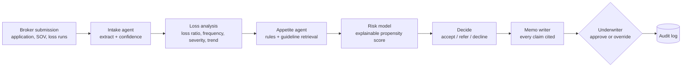

# Risk Decision Copilot

**An AI copilot that turns a commercial insurance submission into a cited, underwriter-ready decision memo, and refers anything it isn't sure about to a human.**

Built as one reusable engine with plug-in domain packs. The flagship pack handles P&C commercial underwriting; the same engine fits commercial lending and health prior authorization.

> All data in this repo is synthetic. No real insureds, policies or personal information.

---

## The business problem

Commercial underwriters spend much of their day on intake work: reading broker submissions, re-keying values, checking appetite guides and writing memos. That work delays quotes, and in commercial lines the fastest credible quote often wins the account. It is also inconsistent: two underwriters reading the same file can reach different conclusions with different documentation.

The copilot does the reading, checking and first draft. The underwriter reviews and decides.

## Results on the 60-case golden set

Measured by `python -m evals.run_evals` against labels written independently of the copilot's own rules ([full report](evals/report.md)):

| What a business owner asks | Metric | Result |
|---|---|---|
| Does it make the same call a senior underwriter would? | Decision accuracy | **98.3%** |
| Does it ever wave through a risk it shouldn't? | Unsafe accepts | **0** |
| Does it ever wrongly decline good business? | Wrongful declines | **0** |
| Can I trust the numbers it pulled? | Field extraction accuracy | **98.0%** |
| Does it handle messy documents safely? | OCR errors, revenue buried in remarks | **11 of 11** handled safely |
| Can every warning be traced? | Warnings with a citation | **100%** |
| Same input, same answer? | Identical memo on re-run | **100%** |
| Does it understand plain-English policy questions? | Free-text guideline Q&A hit@1 / hit@3 | 66.7% / 86.7% (keyword baseline, see roadmap) |

The one miss was the safe kind: revenue appeared only in a free-text remark, so the copilot referred the case instead of trusting an unverified number.

### Example business case

From the [ROI calculator](dashboard/roi_calculator.html) with example inputs (8 underwriters, 600 submissions a month, 45 minutes manual vs. 12 minutes assisted review, 35% referral rate, $60k a year to run):

| | |
|---|---|
| Underwriter hours freed per month | **267** (about 2 FTEs) |
| Net savings per year | **$160,000** |
| Submissions per underwriter per day | **8.7 → 21.3** |

These inputs are illustrative. The calculator exposes every assumption so a team can plug in its own measured times. Freed hours are capacity to quote more business, not necessarily headcount reduction.

## What the underwriter sees

```markdown
# Underwriting Memo: Gulfway Engineering Inc.
**Copilot recommendation:** REFER | **Status:** awaiting underwriter approval

## Account summary
- State: CO | NAICS: 238220 | Years in business: 43
- Annual revenue: $11,330,000 (UNVERIFIED: "Insured reports sales of roughly
  $11,330,000 last fiscal year.", confirm with broker) | TIV: $9,470,000 across 2 locations

## Loss history
- 5-year loss ratio 11% on $269,400 earned premium; 2 claims [loss_run.txt lines 6-10]
- Recurring cause of loss: Vehicle impact (2 of 2 claims)

## Guideline checks
- REFER: [R12] Missing or low-confidence required information: annual_revenue.
  [guidelines.md#6.1] [application.txt line 14]

## Modeled risk
- Large-loss probability: 10% (advisory; refer threshold 25%)
  - Building age raises risk (+0.37) ...
```

## How it works



Design choices that matter in a regulated industry:

- **Decisions are deterministic and cited.** Accept/refer/decline comes from rules tied to numbered guideline sections that the retriever pulls for every finding. The LLM only phrases the memo and is told not to add facts.
- **Uncertainty becomes a referral, never a guess.** Missing fields, OCR-repaired values and figures taken from free text get low confidence, are flagged in the memo, and route the case to a human.
- **The model advises; it never declines.** A transparent logistic regression (holdout AUC 0.80) whose per-feature contributions appear in every memo. See the [model card](docs/model_card.md).
- **Human in the loop and audit trail.** Nothing is final until an underwriter approves; every step and every override is logged with a hash. See [governance](docs/governance.md).

## A bug the evals caught

Many real statements of values end with a TOTAL row. The first version of the extractor summed it as another location, **doubling TIV** on 30% of submissions and producing **5 wrongful declines** on the golden set. The eval harness flagged it, the fix is one line in `copilot/packs/pnc/extract.py`, and a unit test now guards it. This is why the release gate exists: CI blocks any build with an unsafe accept or wrongful decline.

## Quick start

No cloud account or API keys needed.

```bash
pip install -r requirements.txt
make all          # generate synthetic data, train model, run evals + gate, run tests
make demo         # memo for one case
make roi          # business case from the command line
make api          # FastAPI service on localhost:8000
```

Open `dashboard/roi_calculator.html` in a browser for the interactive calculator.

To use Azure, copy `.env.example` to `.env` and set `COPILOT_LLM=azure` (Azure OpenAI) and `COPILOT_RETRIEVER=azure` (Azure AI Search). Deployment notes are in [infra/README.md](infra/README.md).

## Repository layout

```
copilot/engine/        domain-agnostic: schemas, orchestrator, retrieval, LLM switch, audit log
copilot/packs/pnc/     P&C pack: guidelines, extraction, loss analysis, rules, risk model, memo
copilot/packs/lending/ commercial lending pack (scaffold with mapping: loss ratio -> DSCR, etc.)
data/synth/            synthetic data generator with realistic document quirks
models/                model training + metrics
evals/                 golden-set evals, thresholds, release gate, report
roi/  dashboard/       ROI model and interactive calculator
api/                   FastAPI service
docs/                  model card, governance
```

## Same engine, other industries

| | P&C underwriting | Commercial lending | Health prior auth |
|---|---|---|---|
| Documents | Application, SOV, loss runs | Financials, credit report | Clinical notes, request form |
| Key metric | Loss ratio | Debt service coverage | Criteria met / not met |
| Policy | Appetite guide | Credit policy | Medical policy |
| Output | Underwriting memo | Credit memo | Approve / refer summary |

A new pack implements six steps and supplies its policy document. The orchestrator, retrieval, audit log, eval harness and ROI calculator are reused unchanged.

## Roadmap

- [ ] Hybrid vector search in Azure AI Search to lift free-text guideline Q&A above the 67% keyword baseline
- [ ] Azure AI Document Intelligence for scanned PDFs (ACORD 125/140)
- [ ] Bicep templates and Container Apps deployment
- [ ] Fabric Lakehouse + Power BI view of decisions, overrides and loss ratio by segment
- [ ] Complete the commercial lending pack
- [ ] LangGraph or Microsoft Agent Framework orchestration (each step is already a graph-ready node)

## Limitations

The data is synthetic, so results show the method, not real-world performance. Labels come from a rule-following "senior underwriter" function, which is cleaner than real underwriting judgment. The golden set is weighted toward edge cases, which is why it refers 53% of cases. Time savings depend on a team's measured baseline.
